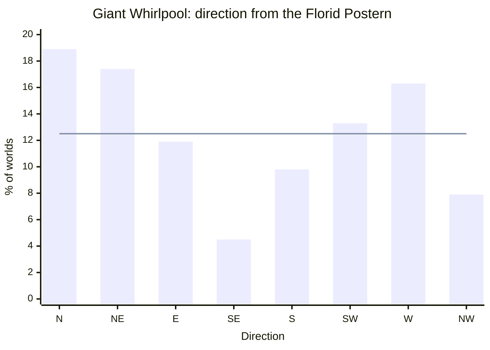
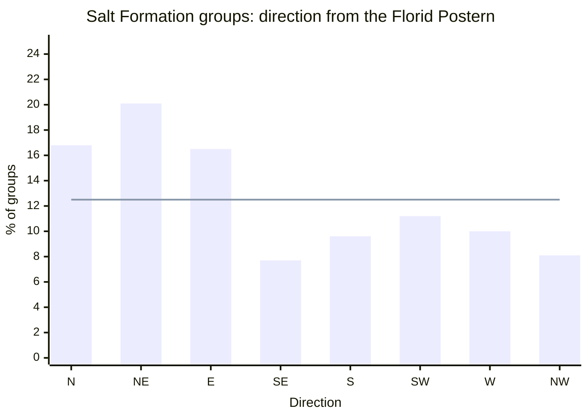
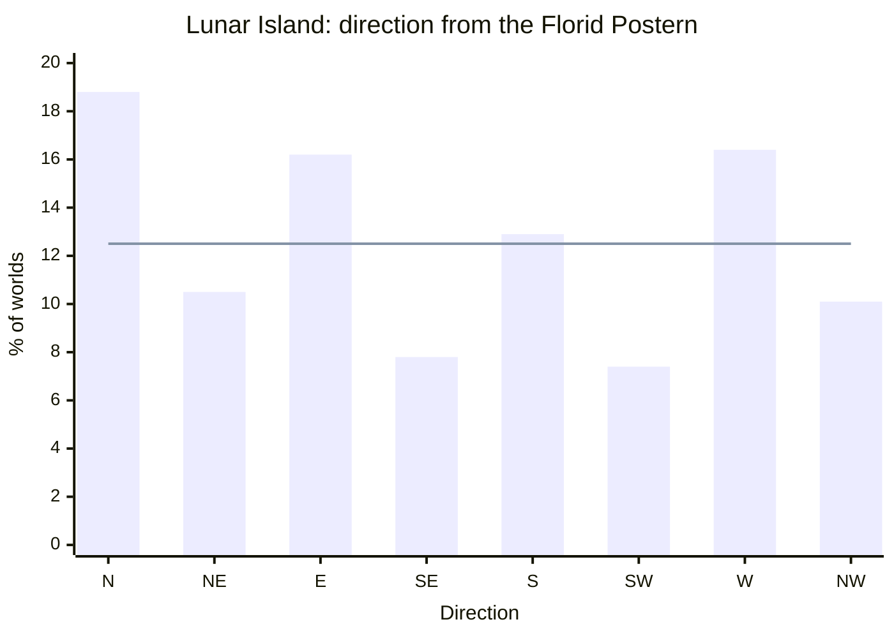
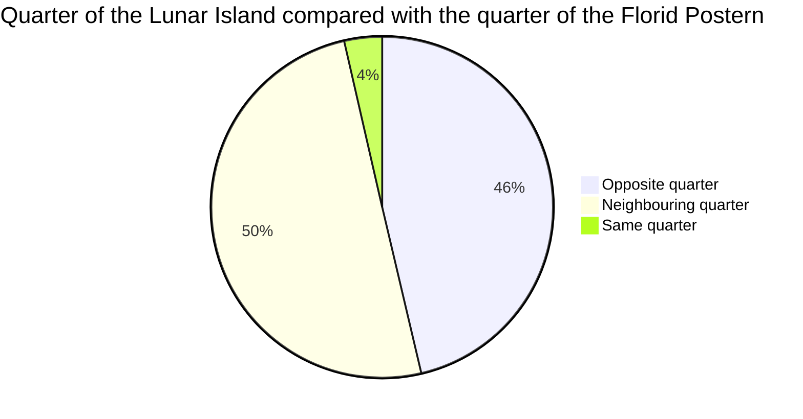
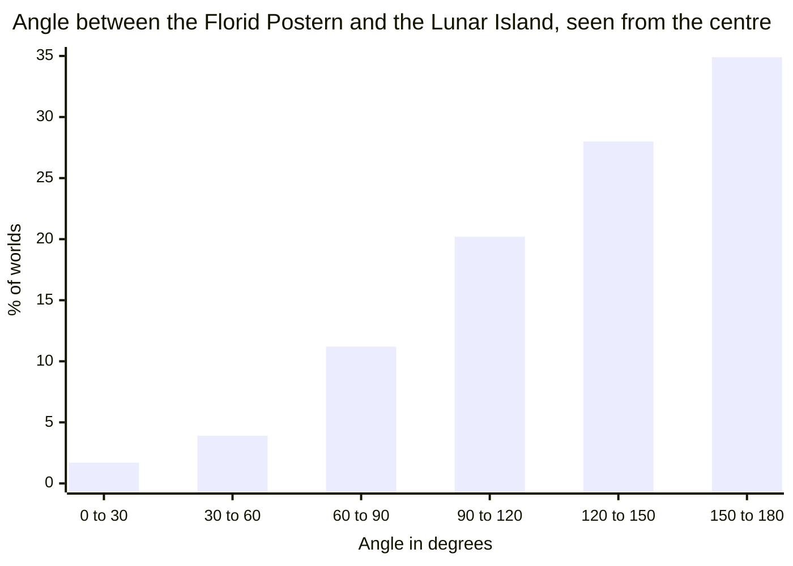
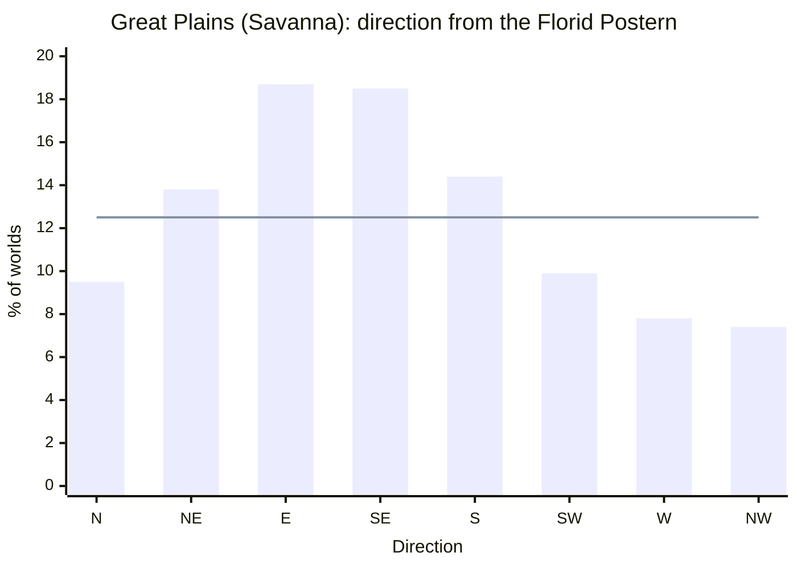
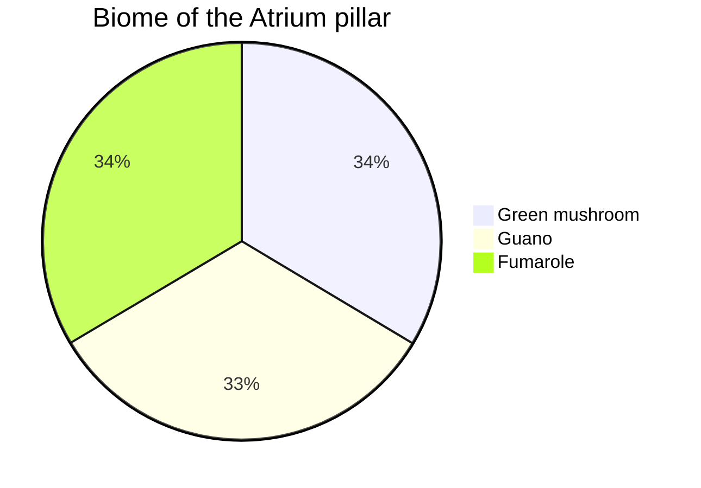
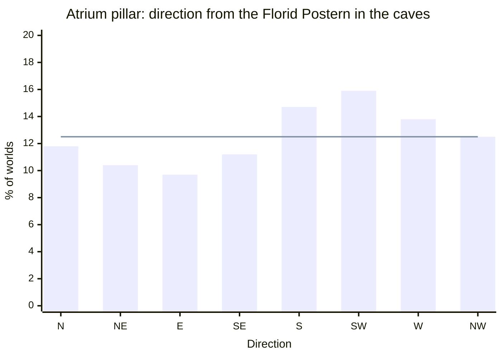
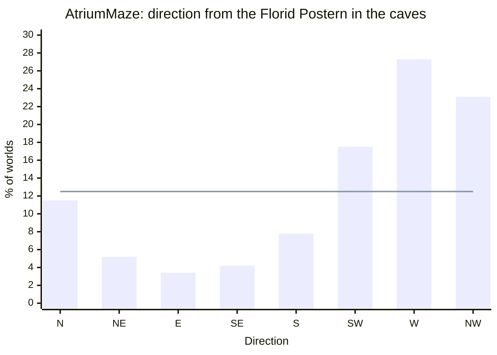

# Where things are on the map

This data was computed by generating 1 million forest and 1 million cave worlds on version 762172 on Windows. Some seeds
are not possible (usually the worldgen algorithm gives up), so in this case 7,469 forest and 23,845 cave seeds failed to
generate.

## How to read this

This document showcases where things are relative to the direction you're looking at. The game (for whatever reason)
spawns you at a 45 degree angle, so by that is what I've defined north here. The graphs in this data will mostly be
shown from the Florid Postern, but the tables show both. All distances here are in tiles (not units!).

If everything was perfectly uniform each one of these numbers would average to 12.5% (but it isn't!), so this is what
the green line on every one of these graphs shows.

## Giant Whirlpool

One of these spawns in every world, from the Florid Postern it is most often to the N (18.9%), NE (17.4%) and W
(16.3%), and least often to the SE (4.5%) and NW (7.9%). It is usually 161 to 245 tiles away from the portal. 

**Giant Whirlpool: share of worlds in each direction**

| Direction | From the Florid Postern | From the centre of the map |
| --- | ---: | ---: |
| N | 18.9% | 20.8% |
| NE | 17.4% | 15.2% |
| E | 11.9% | 12.6% |
| SE | 4.5% | 3.7% |
| S | 9.8% | 10.5% |
| SW | 13.3% | 12.3% |
| W | 16.3% | 17.9% |
| NW | 7.9% | 7.0% |

## Salt Formations

Salt Formations always come in 8 groups per world, with about 122 formations in all (never fewer than 84 or more than
134). From the Florid Postern the groups are most often to the NE (20.1%), N (16.8%) and E (16.5%), and least often to
the SE (7.7%) and NW (8.1%).

**Salt Formation groups: share of groups in each direction**

| Direction | From the Florid Postern | From the centre of the map |
| --- | ---: | ---: |
| N | 16.8% | 18.3% |
| NE | 20.1% | 17.5% |
| E | 16.5% | 17.7% |
| SE | 7.7% | 7.0% |
| S | 9.6% | 10.6% |
| SW | 11.2% | 10.6% |
| W | 10.0% | 10.9% |
| NW | 8.1% | 7.4% |

## Lunar Island

From the Florid Postern the Lunar Island is most often to the N (18.8%), W (16.4%) and E (16.2%), and least often to the
SW (7.4%) and SE (7.8%).

However, when measuring from the center, the island is nearly always straight up, down, left or
right: N (23.4%), W (20.7%), E (19.5%) and S (16.4%). It's very rarely diagonally placed: SW (4.0%), SE (4.3%), 
NW (5.8%) and NE (5.8%).

**Lunar Island: share of worlds in each direction**

| Direction | From the Florid Postern | From the centre of the map |
| --- | ---: | ---: |
| N | 18.8% | 23.4% |
| NE | 10.5% | 5.8% |
| E | 16.2% | 19.5% |
| SE | 7.8% | 4.3% |
| S | 12.9% | 16.4% |
| SW | 7.4% | 4.0% |
| W | 16.4% | 20.7% |
| NW | 10.1% | 5.8% |

### Is it on the opposite side of the map from where you spawn?

Usually it is on the far side. If you cut the map into four quarters around its centre (N, E, S and W) and take the quarter
that holds most of the island you'll see that in 46.3% of the worlds that is the quarter opposite the Florid Postern's, in 50.1% a
neighbouring quarter, and in only 3.6% the same quarter. 

Cutting the map into its four corners instead (NE, SE, SW and NW) gives much the same answer: 48.9% opposite, 44.6%
neighbouring and 6.5% the same.

## Forest biomes

See [tasks.md](tasks.md) on information on how these connect. From the Florid Postern the mainland biomes only lean a
little: the most common direction of each has 13% to 19% of the worlds, where an even spread would give 12.5%. The
strongest is Great Plains (Savanna): most often E (18.7%), SE (18.5%) and S (14.4%), least often NW (7.4%) and W (7.8%).

### From the Florid Postern

**Forest biomes: share of worlds in each direction from the Florid Postern**

| Biome | In worlds | N | NE | E | SE | S | SW | W | NW | Distance |
| --- | ---: | ---: | ---: | ---: | ---: | ---: | ---: | ---: | ---: | ---: |
| Make a pick (Spawn) | 100% | 12.9% | **13.1%** | 12.5% | 12.2% | 11.9% | 12.2% | 12.5% | 12.8% | 22 |
| Dig that rock (Mosaic) | 100% | 12.3% | 11.1% | 11.3% | 11.6% | 13.3% | 13.7% | **14.0%** | 12.6% | 71 |
| Great Plains (Savanna) | 100% | 9.5% | 13.8% | **18.7%** | 18.5% | 14.4% | 9.9% | 7.8% | 7.4% | 96 |
| Squeltch (Marsh) | 100% | 13.6% | 12.6% | 11.6% | 10.2% | 10.8% | 12.6% | **14.5%** | 14.2% | 127 |
| Beeeees! (Bee Queen) | 100% | 13.0% | 14.3% | **14.4%** | 13.5% | 12.0% | 10.9% | 10.6% | 11.4% | 88 |
| Speak to the king (Pig King) | 100% | 13.7% | 14.3% | **14.7%** | 13.2% | 11.6% | 10.3% | 10.6% | 11.6% | 123 |
| Forest hunters (Moonstone Forest) | 100% | **16.7%** | 15.4% | 12.2% | 9.4% | 8.9% | 10.2% | 12.4% | 14.8% | 153 |
| For a nice walk (Mandrake Forest) | 100% | 14.1% | 11.9% | 10.5% | 9.6% | 10.7% | 12.9% | **15.5%** | 14.8% | 118 |
| Badlands (Dragonfly Desert) | 100% | 10.2% | 13.5% | **16.6%** | 15.7% | 13.7% | 11.6% | 9.9% | 8.8% | 155 |
| Lightning Bluff (Oasis Desert) | 100% | **13.3%** | 12.9% | 11.9% | 11.4% | 11.8% | 12.7% | 13.0% | 13.1% | 132 |
| Befriend the pigs (Pig Forest) | 50% | 11.0% | 12.9% | 14.6% | **14.8%** | 14.4% | 12.2% | 10.5% | 9.7% | 82 |
| Kill the spiders (Spider Quarry) | 50% | 12.0% | 12.1% | 12.2% | 12.8% | 12.6% | **12.9%** | 12.8% | 12.5% | 123 |
| Killer bees! (Killer Bee Field) | 50% | **13.7%** | 13.6% | 11.9% | 10.7% | 11.3% | 12.8% | 13.0% | 12.9% | 150 |
| Make a Beehat (Bee Meteor Biome) | 50% | 12.0% | 10.2% | 9.4% | 9.7% | 12.3% | 15.8% | **16.5%** | 14.0% | 129 |
| The hunters (Triple MacTusk) | 50% | 10.3% | 13.4% | **17.1%** | 17.0% | 14.5% | 10.7% | 8.7% | 8.4% | 163 |
| Magic meadow (Frog Ponds) | 50% | 11.6% | 13.1% | **14.2%** | 14.2% | 13.3% | 11.9% | 10.9% | 10.6% | 62 |
| Frogs and bugs (Frog Ponds and Beehives) | 50% | 11.9% | 13.3% | **14.3%** | 14.1% | 12.9% | 11.5% | 11.0% | 11.1% | 66 |
| Mole Colony Deciduous (Second Deciduous) | 50% | 13.4% | **14.5%** | 14.3% | 13.0% | 12.1% | 10.7% | 10.5% | 11.6% | 98 |
| Mole Colony Rocks (Rocky Biome) | 50% | 11.8% | 12.1% | 13.1% | 12.8% | **13.1%** | 12.8% | 12.8% | 11.5% | 103 |
| MooseBreedingTask (Quad Moose) | 50% | 12.5% | 13.8% | **14.6%** | 13.8% | 12.1% | 11.1% | 10.8% | 11.3% | 81 |
| MoonIsland_Baths | 100% | **18.4%** | 11.4% | 15.7% | 8.1% | 12.5% | 7.4% | 15.9% | 10.6% | 207 |
| MoonIsland_Beach | 100% | **19.5%** | 8.8% | 17.0% | 7.1% | 13.7% | 7.3% | 17.3% | 9.3% | 215 |
| MoonIsland_Forest | 100% | **16.8%** | 13.6% | 14.4% | 9.4% | 11.3% | 8.1% | 14.4% | 12.0% | 190 |
| MoonIsland_IslandShards | 100% | **18.1%** | 8.5% | 16.5% | 7.8% | 13.4% | 9.1% | 16.6% | 10.1% | 197 |
| MoonIsland_Mine | 100% | **17.5%** | 13.4% | 14.5% | 8.9% | 11.6% | 7.5% | 14.8% | 11.8% | 226 |

### From the centre of the map

**Forest biomes: share of worlds in each direction from the centre of the map**

| Biome | In worlds | N | NE | E | SE | S | SW | W | NW | Distance |
| --- | ---: | ---: | ---: | ---: | ---: | ---: | ---: | ---: | ---: | ---: |
| Make a pick (Spawn) | 100% | 11.3% | 10.4% | 12.3% | 11.5% | 14.2% | 14.1% | **15.1%** | 11.1% | 66 |
| Dig that rock (Mosaic) | 100% | 11.0% | 11.0% | 11.0% | 11.7% | 13.5% | **15.2%** | 13.9% | 12.8% | 108 |
| Great Plains (Savanna) | 100% | 9.3% | 11.9% | 17.2% | **18.6%** | 16.1% | 10.5% | 8.8% | 7.7% | 95 |
| Squeltch (Marsh) | 100% | 13.1% | 11.3% | 11.5% | 9.6% | 11.9% | 13.0% | **15.7%** | 14.0% | 107 |
| Beeeees! (Bee Queen) | 100% | 12.4% | 11.9% | **14.5%** | 12.8% | 14.3% | 11.3% | 12.1% | 10.6% | 85 |
| Speak to the king (Pig King) | 100% | 13.4% | 12.8% | **14.9%** | 12.6% | 13.3% | 10.0% | 11.7% | 11.3% | 113 |
| Forest hunters (Moonstone Forest) | 100% | **17.1%** | 13.9% | 12.4% | 8.5% | 9.7% | 9.8% | 14.0% | 14.7% | 137 |
| For a nice walk (Mandrake Forest) | 100% | 13.0% | 11.2% | 10.0% | 9.4% | 11.7% | 13.9% | **15.9%** | 14.9% | 117 |
| Badlands (Dragonfly Desert) | 100% | 10.3% | 11.7% | **16.9%** | 15.5% | 16.1% | 11.0% | 10.3% | 8.2% | 138 |
| Lightning Bluff (Oasis Desert) | 100% | 13.0% | 11.2% | 11.8% | 10.6% | 13.2% | 13.0% | **14.6%** | 12.6% | 123 |
| Befriend the pigs (Pig Forest) | 50% | 10.7% | 11.6% | 13.6% | 14.2% | **15.6%** | 13.1% | 11.5% | 9.6% | 83 |
| Kill the spiders (Spider Quarry) | 50% | 11.8% | 10.5% | 12.6% | 11.6% | 14.1% | 13.1% | **14.7%** | 11.6% | 120 |
| Killer bees! (Killer Bee Field) | 50% | 13.9% | 11.6% | 12.5% | 9.9% | 13.2% | 12.4% | **14.5%** | 12.0% | 128 |
| Make a Beehat (Bee Meteor Biome) | 50% | 11.4% | 8.5% | 8.8% | 8.9% | 13.9% | 16.5% | **18.6%** | 13.4% | 123 |
| The hunters (Triple MacTusk) | 50% | 10.4% | 11.8% | **17.7%** | 16.1% | 16.5% | 10.3% | 9.3% | 7.7% | 140 |
| Magic meadow (Frog Ponds) | 50% | 10.5% | 11.0% | 13.2% | 13.7% | **15.2%** | 13.6% | 12.3% | 10.5% | 77 |
| Frogs and bugs (Frog Ponds and Beehives) | 50% | 10.4% | 10.9% | 13.6% | 14.2% | **15.3%** | 12.8% | 12.4% | 10.4% | 70 |
| Mole Colony Deciduous (Second Deciduous) | 50% | 12.6% | 13.0% | **13.9%** | 12.7% | 13.4% | 11.3% | 11.8% | 11.3% | 96 |
| Mole Colony Rocks (Rocky Biome) | 50% | 10.7% | 12.0% | 12.3% | 13.1% | 12.8% | **14.2%** | 13.1% | 11.8% | 123 |
| MooseBreedingTask (Quad Moose) | 50% | 11.7% | 11.1% | 15.0% | 13.2% | **15.1%** | 11.5% | 12.5% | 9.9% | 76 |
| MoonIsland_Baths | 100% | **22.6%** | 7.0% | 18.6% | 5.0% | 15.6% | 4.5% | 19.8% | 6.8% | 162 |
| MoonIsland_Beach | 100% | **23.8%** | 4.6% | 20.3% | 3.7% | 17.2% | 3.9% | 21.5% | 5.0% | 172 |
| MoonIsland_Forest | 100% | **19.6%** | 10.8% | 15.9% | 7.3% | 13.2% | 6.2% | 16.9% | 10.0% | 146 |
| MoonIsland_IslandShards | 100% | **21.7%** | 4.5% | 19.2% | 4.8% | 16.5% | 6.4% | 20.3% | 6.6% | 157 |
| MoonIsland_Mine | 100% | **20.2%** | 10.7% | 15.9% | 7.1% | 13.2% | 5.9% | 16.9% | 10.1% | 182 |

## The Atrium pillar (caves)

**Atrium pillar: share of worlds in each direction from the Florid Postern in the caves**

| Direction | Any biome | Green mushroom | Guano | Fumarole |
| --- | ---: | ---: | ---: | ---: |
| N | 11.8% | 11.3% | 13.4% | 10.7% |
| NE | 10.4% | 9.8% | 10.9% | 10.6% |
| E | 9.7% | 9.3% | 8.9% | 10.9% |
| SE | 11.2% | 11.0% | 9.7% | 12.8% |
| S | 14.7% | 15.1% | 13.3% | 15.8% |
| SW | 15.9% | 16.6% | 15.1% | 16.1% |
| W | 13.8% | 14.4% | 14.6% | 12.3% |
| NW | 12.5% | 12.5% | 14.2% | 10.8% |

**Atrium pillar: share of worlds in each direction from the centre of the cave map**

| Direction | Any biome | Green mushroom | Guano | Fumarole |
| --- | ---: | ---: | ---: | ---: |
| N | 11.3% | 9.1% | 12.8% | 11.9% |
| NE | 13.1% | 11.8% | 15.5% | 12.1% |
| E | 17.0% | 17.2% | 17.8% | 15.9% |
| SE | 17.9% | 21.7% | 15.7% | 16.3% |
| S | 18.1% | 19.5% | 14.1% | 20.6% |
| SW | 9.8% | 9.7% | 9.1% | 10.8% |
| W | 6.2% | 5.3% | 7.3% | 6.1% |
| NW | 6.6% | 5.7% | 7.7% | 6.2% |

## Cave biomes

Cave biomes are more effected by directions than the forest ones, especially the ruins.
14 of the 51 biomes are on the west side of the caves' Florid Postern (W, NW or SW) in 59% to 68% of the worlds, and to 
the E in only 3% to 5%: all ruins biomes but ArchiveMaze. Their most common direction is W or NW, with 21% to 27% of the worlds.

### From the Florid Postern in the caves

**Cave biomes: share of worlds in each direction from the Florid Postern in the caves**

| Biome | In worlds | N | NE | E | SE | S | SW | W | NW | Distance |
| --- | ---: | ---: | ---: | ---: | ---: | ---: | ---: | ---: | ---: | ---: |
| ArchiveMaze | 100% | **16.7%** | 14.1% | 10.6% | 10.1% | 9.7% | 10.7% | 12.7% | 15.5% | 181 |
| AtriumMaze | 100% | 11.5% | 5.2% | 3.4% | 4.2% | 7.8% | 17.5% | **27.3%** | 23.1% | 226 |
| BigBatCave | 100% | 13.5% | 11.0% | 8.9% | 9.8% | 13.2% | **15.0%** | 14.5% | 14.1% | 136 |
| BlueForest | 100% | 15.8% | 11.1% | 7.9% | 9.0% | 11.3% | 13.2% | 15.1% | **16.6%** | 138 |
| CaveExitTask1 | 100% | 12.5% | 10.7% | 9.4% | 11.0% | 14.1% | **15.0%** | 13.9% | 13.3% | 140 |
| CaveExitTask2 | 100% | **14.8%** | 12.1% | 9.7% | 10.4% | 12.3% | 13.0% | 13.3% | 14.4% | 139 |
| CaveExitTask3 | 100% | 13.0% | 11.3% | 10.0% | 11.3% | 13.9% | **14.3%** | 13.1% | 13.0% | 133 |
| CaveExitTask4 | 100% | 12.3% | 11.8% | 11.0% | 12.8% | **15.4%** | 13.9% | 11.4% | 11.3% | 132 |
| CaveExitTask5 | 100% | **14.7%** | 12.8% | 10.8% | 10.8% | 11.9% | 12.5% | 12.7% | 13.9% | 127 |
| CaveExitTask6 | 100% | **16.0%** | 12.7% | 9.8% | 9.4% | 10.7% | 12.2% | 13.5% | 15.6% | 115 |
| CaveExitTask7 | 100% | 13.5% | **13.5%** | 12.4% | 12.8% | 13.4% | 12.2% | 10.7% | 11.5% | 125 |
| CaveExitTask8 | 100% | **16.2%** | 15.8% | 13.0% | 11.7% | 10.7% | 9.8% | 10.1% | 12.8% | 122 |
| CaveExitTask9 | 100% | 13.8% | **13.8%** | 12.8% | 12.8% | 13.2% | 11.8% | 10.3% | 11.4% | 126 |
| CaveExitTask10 | 100% | 13.0% | 13.3% | 12.5% | 13.0% | **13.8%** | 12.5% | 10.7% | 11.2% | 126 |
| CentipedeCaveTask | 100% | 10.8% | 10.7% | 10.9% | 12.7% | 15.8% | **16.2%** | 12.2% | 10.7% | 170 |
| GreenForest | 100% | 11.1% | 9.9% | 9.2% | 11.0% | 15.2% | **16.6%** | 14.4% | 12.5% | 125 |
| LichenLand | 100% | 13.0% | 6.8% | 4.6% | 5.5% | 10.3% | 17.8% | **21.8%** | 20.1% | 158 |
| Military | 100% | 11.8% | 5.3% | 3.5% | 4.4% | 8.6% | 18.1% | **26.0%** | 22.4% | 222 |
| MoonCaveForest | 100% | **16.3%** | 12.4% | 9.2% | 9.7% | 10.6% | 11.7% | 13.9% | 16.1% | 154 |
| MudCave | 100% | 12.9% | 8.9% | 7.0% | 8.4% | 13.1% | 16.7% | **17.0%** | 15.9% | 129 |
| MudLights | 100% | 14.1% | 10.1% | 7.7% | 8.8% | 12.8% | 15.2% | 15.6% | **15.7%** | 122 |
| MudPit | 100% | 13.6% | 9.6% | 7.1% | 8.4% | 13.0% | 16.0% | **16.3%** | 15.9% | 124 |
| MudWorld | 100% | 13.6% | 8.7% | 6.3% | 7.5% | 12.4% | 16.7% | **17.7%** | 17.0% | 129 |
| RedForest | 100% | 12.4% | 11.3% | 10.2% | 12.2% | **15.7%** | 14.7% | 11.9% | 11.6% | 131 |
| Residential | 100% | 12.1% | 6.0% | 4.1% | 4.9% | 9.3% | 18.3% | **24.2%** | 21.1% | 188 |
| RockyLand | 100% | **15.0%** | 12.3% | 10.0% | 10.5% | 12.3% | 12.7% | 12.9% | 14.3% | 126 |
| Sacred | 100% | 12.3% | 6.3% | 4.2% | 4.8% | 8.7% | 17.7% | **24.7%** | 21.3% | 234 |
| SacredAltar | 100% | 12.5% | 5.7% | 3.7% | 4.5% | 8.7% | 17.5% | **25.1%** | 22.4% | 253 |
| SpillagmiteCaverns | 100% | 11.6% | 9.2% | 8.1% | 9.9% | 14.3% | **17.0%** | 15.9% | 13.9% | 139 |
| TheLabyrinth | 100% | 12.2% | 5.7% | 3.7% | 4.3% | 8.1% | 17.3% | **26.2%** | 22.5% | 274 |
| ToadStoolTask1 | 100% | 13.5% | 9.6% | 7.2% | 8.4% | 12.8% | 16.1% | **16.5%** | 15.9% | 128 |
| ToadStoolTask2 | 100% | 11.9% | 10.5% | 9.6% | 10.9% | 14.4% | **15.7%** | 14.1% | 12.8% | 138 |
| ToadStoolTask3 | 100% | **14.5%** | 12.2% | 10.1% | 10.7% | 12.5% | 13.1% | 12.9% | 13.9% | 142 |
| BatCloister | 45% | 12.6% | 10.8% | 9.6% | 11.1% | 14.3% | **15.1%** | 13.5% | 12.9% | 144 |
| CaveJungle | 44% | 14.4% | 6.8% | 4.1% | 4.3% | 7.7% | 15.8% | **23.6%** | 23.4% | 184 |
| CaveSwamp | 45% | 12.2% | 10.5% | 9.9% | 11.2% | 14.1% | **15.2%** | 13.8% | 13.2% | 155 |
| FungalNoiseForest | 45% | 10.2% | 10.6% | 11.1% | 13.2% | **16.5%** | 15.8% | 12.3% | 10.4% | 136 |
| FungalNoiseMeadow | 44% | **17.8%** | 15.4% | 11.4% | 9.9% | 9.5% | 9.7% | 11.4% | 15.0% | 135 |
| MilitaryPits | 43% | 11.8% | 6.1% | 4.3% | 5.3% | 9.7% | 18.2% | **24.1%** | 20.5% | 222 |
| MoreAltars | 45% | 12.2% | 6.9% | 5.4% | 6.2% | 9.6% | 16.8% | **22.7%** | 20.1% | 248 |
| MuddySacred | 45% | 10.8% | 5.6% | 4.1% | 5.2% | 9.9% | 19.6% | **25.2%** | 19.4% | 258 |
| PleasantSinkhole | 45% | 10.8% | 11.7% | 11.7% | 13.4% | **16.8%** | 14.9% | 10.9% | 9.8% | 134 |
| RabbitCity | 45% | **13.9%** | 13.1% | 11.5% | 11.7% | 12.6% | 12.4% | 12.1% | 12.8% | 119 |
| RabbitSpiderWar | 45% | 11.1% | 11.4% | 11.2% | 13.3% | **16.0%** | 14.6% | 11.6% | 10.7% | 155 |
| RabbitTown | 45% | 13.1% | 10.9% | 9.9% | 10.7% | 13.2% | **14.3%** | 13.9% | 13.9% | 122 |
| Residential2 | 44% | 15.9% | 7.1% | 3.6% | 3.7% | 7.2% | 14.9% | 23.1% | **24.5%** | 177 |
| Residential3 | 44% | 11.3% | 6.2% | 5.0% | 6.7% | 12.0% | 18.9% | **21.5%** | 18.5% | 167 |
| SacredDanger | 44% | 11.9% | 6.5% | 5.0% | 6.0% | 9.4% | 17.1% | **23.8%** | 20.4% | 255 |
| SpiderLand | 44% | 11.5% | 9.9% | 9.2% | 10.9% | 14.4% | **16.4%** | 14.8% | 12.9% | 151 |
| SwampySinkhole | 45% | **14.7%** | 13.1% | 11.5% | 11.8% | 12.1% | 11.8% | 11.7% | 13.3% | 153 |
| UndergroundForest | 45% | **16.0%** | 13.0% | 10.2% | 9.9% | 11.1% | 12.4% | 12.8% | 14.7% | 125 |

### From the centre of the cave map

Measured from the centre of the cave map, the same 14 biomes are the ones most often on the west side (W, NW or SW).
Every other biome is most often to the NE, E, SE or S.

**Cave biomes: share of worlds in each direction from the centre of the cave map**

| Biome | In worlds | N | NE | E | SE | S | SW | W | NW | Distance |
| --- | ---: | ---: | ---: | ---: | ---: | ---: | ---: | ---: | ---: | ---: |
| ArchiveMaze | 100% | 15.8% | **18.8%** | 17.2% | 11.0% | 8.7% | 9.1% | 9.0% | 10.4% | 174 |
| AtriumMaze | 100% | 11.0% | 5.0% | 2.8% | 3.9% | 6.8% | 16.1% | **30.6%** | 23.6% | 130 |
| BigBatCave | 100% | 12.9% | 15.6% | **17.5%** | 15.6% | 14.0% | 9.3% | 7.3% | 7.8% | 110 |
| BlueForest | 100% | 15.6% | **19.0%** | 18.1% | 11.3% | 8.9% | 8.6% | 8.6% | 9.8% | 100 |
| CaveExitTask1 | 100% | 11.2% | 14.1% | 16.5% | **18.0%** | 15.5% | 10.1% | 6.9% | 7.8% | 121 |
| CaveExitTask2 | 100% | 13.1% | 17.6% | **18.5%** | 15.5% | 11.9% | 8.4% | 6.8% | 8.2% | 121 |
| CaveExitTask3 | 100% | 11.0% | 15.2% | 18.2% | **18.6%** | 14.5% | 9.0% | 6.3% | 7.2% | 121 |
| CaveExitTask4 | 100% | 9.2% | 14.9% | 20.5% | **22.0%** | 15.2% | 7.8% | 5.1% | 5.4% | 122 |
| CaveExitTask5 | 100% | 14.4% | **17.8%** | 17.3% | 15.2% | 12.8% | 8.7% | 6.4% | 7.6% | 148 |
| CaveExitTask6 | 100% | 14.7% | **19.4%** | 18.7% | 15.3% | 11.4% | 7.5% | 5.8% | 7.3% | 108 |
| CaveExitTask7 | 100% | 11.9% | 17.3% | **19.8%** | 18.0% | 13.8% | 7.8% | 5.3% | 6.2% | 150 |
| CaveExitTask8 | 100% | 14.1% | 20.8% | **21.4%** | 15.5% | 10.3% | 6.2% | 5.2% | 6.6% | 152 |
| CaveExitTask9 | 100% | 12.2% | 17.8% | **20.3%** | 17.9% | 13.5% | 7.0% | 5.1% | 6.2% | 150 |
| CaveExitTask10 | 100% | 11.3% | 16.7% | **20.0%** | 18.9% | 14.2% | 7.6% | 5.2% | 6.1% | 149 |
| CentipedeCaveTask | 100% | 12.0% | 12.1% | 15.9% | 16.2% | **20.7%** | 10.8% | 6.1% | 6.2% | 165 |
| GreenForest | 100% | 9.1% | 11.6% | 16.9% | **21.9%** | 19.7% | 9.8% | 5.3% | 5.8% | 105 |
| LichenLand | 100% | 12.2% | 6.5% | 4.2% | 5.3% | 9.2% | 17.5% | **25.0%** | 20.1% | 41 |
| Military | 100% | 12.1% | 4.5% | 3.3% | 3.8% | 8.4% | 17.5% | **27.9%** | 22.6% | 123 |
| MoonCaveForest | 100% | 15.5% | **18.9%** | 17.3% | 11.5% | 8.8% | 9.0% | 8.7% | 10.3% | 132 |
| MudCave | 100% | 10.0% | 13.0% | 16.8% | **18.8%** | 16.9% | 10.8% | 6.8% | 6.9% | 54 |
| MudLights | 100% | 12.2% | 16.7% | **23.4%** | 17.9% | 13.1% | 5.8% | 5.6% | 5.4% | 58 |
| MudPit | 100% | 11.7% | 14.9% | **20.8%** | 18.0% | 14.8% | 7.6% | 6.3% | 5.9% | 56 |
| MudWorld | 100% | 10.0% | 15.1% | 18.4% | **20.0%** | 13.9% | 8.9% | 6.6% | 7.0% | 30 |
| RedForest | 100% | 7.5% | 15.1% | 21.8% | **25.2%** | 15.8% | 7.1% | 3.7% | 3.8% | 100 |
| Residential | 100% | 13.3% | 4.3% | 4.3% | 3.6% | 10.0% | 14.9% | **32.6%** | 17.0% | 80 |
| RockyLand | 100% | 13.3% | 19.4% | **22.8%** | 16.0% | 11.5% | 5.8% | 5.1% | 6.0% | 100 |
| Sacred | 100% | 14.0% | 6.4% | 4.8% | 4.4% | 9.3% | 16.5% | **26.1%** | 18.7% | 136 |
| SacredAltar | 100% | 13.8% | 5.6% | 3.7% | 4.3% | 9.3% | 17.3% | **23.4%** | 22.6% | 161 |
| SpillagmiteCaverns | 100% | 9.3% | 12.1% | 15.0% | **18.6%** | 18.5% | 13.0% | 6.8% | 6.9% | 95 |
| TheLabyrinth | 100% | 13.7% | 5.3% | 4.1% | 3.8% | 8.7% | 15.5% | **27.9%** | 21.0% | 178 |
| ToadStoolTask1 | 100% | 12.8% | 14.7% | **18.2%** | 16.2% | 14.5% | 9.0% | 7.1% | 7.5% | 63 |
| ToadStoolTask2 | 100% | 10.6% | 13.1% | 17.2% | **19.2%** | 16.8% | 9.9% | 6.2% | 7.0% | 115 |
| ToadStoolTask3 | 100% | 12.9% | 18.7% | **19.8%** | 16.1% | 12.3% | 7.9% | 5.6% | 6.8% | 113 |
| BatCloister | 45% | 11.7% | 14.8% | 17.0% | **17.4%** | 16.2% | 9.6% | 6.3% | 6.9% | 120 |
| CaveJungle | 44% | 15.3% | 7.8% | 3.6% | 3.9% | 5.9% | 13.7% | 22.1% | **27.7%** | 82 |
| CaveSwamp | 45% | 12.7% | 14.3% | 15.2% | **16.5%** | 16.1% | 10.3% | 6.5% | 8.4% | 137 |
| FungalNoiseForest | 45% | 7.8% | 10.8% | 17.7% | **22.7%** | 19.8% | 10.3% | 5.6% | 5.3% | 140 |
| FungalNoiseMeadow | 44% | 17.5% | **22.7%** | 21.3% | 11.4% | 7.4% | 5.2% | 6.4% | 8.0% | 137 |
| MilitaryPits | 43% | 12.6% | 6.0% | 4.6% | 5.3% | 10.4% | 18.0% | **24.4%** | 18.6% | 123 |
| MoreAltars | 45% | 13.7% | 7.3% | 6.5% | 6.0% | 10.3% | 14.7% | **23.4%** | 18.0% | 155 |
| MuddySacred | 45% | 11.5% | 6.0% | 4.7% | 5.2% | 10.4% | 19.6% | **25.8%** | 16.8% | 168 |
| PleasantSinkhole | 45% | 6.6% | 11.7% | 20.5% | **26.4%** | 19.2% | 8.0% | 3.7% | 3.8% | 136 |
| RabbitCity | 45% | 12.3% | 18.5% | **22.3%** | 16.7% | 12.3% | 7.1% | 5.0% | 5.8% | 126 |
| RabbitSpiderWar | 45% | 10.0% | 13.5% | 20.2% | **21.1%** | 16.1% | 7.4% | 5.3% | 6.4% | 130 |
| RabbitTown | 45% | 13.8% | **17.1%** | 16.8% | 16.0% | 14.9% | 9.0% | 5.4% | 6.9% | 120 |
| Residential2 | 44% | 18.9% | 10.9% | 3.5% | 4.5% | 5.4% | 11.0% | 14.8% | **31.0%** | 75 |
| Residential3 | 44% | 9.9% | 7.1% | 5.0% | 9.0% | 12.4% | **20.9%** | 17.7% | 17.9% | 59 |
| SacredDanger | 44% | 13.0% | 6.9% | 5.9% | 6.0% | 9.8% | 15.8% | **23.9%** | 18.8% | 163 |
| SpiderLand | 44% | 10.7% | 13.0% | 15.1% | 17.5% | **19.1%** | 12.4% | 6.6% | 5.5% | 125 |
| SwampySinkhole | 45% | 13.3% | 18.7% | **19.1%** | 15.9% | 11.4% | 8.0% | 5.9% | 7.6% | 137 |
| UndergroundForest | 45% | 13.3% | **20.9%** | 19.4% | 14.9% | 12.8% | 7.8% | 5.7% | 5.2% | 130 |
