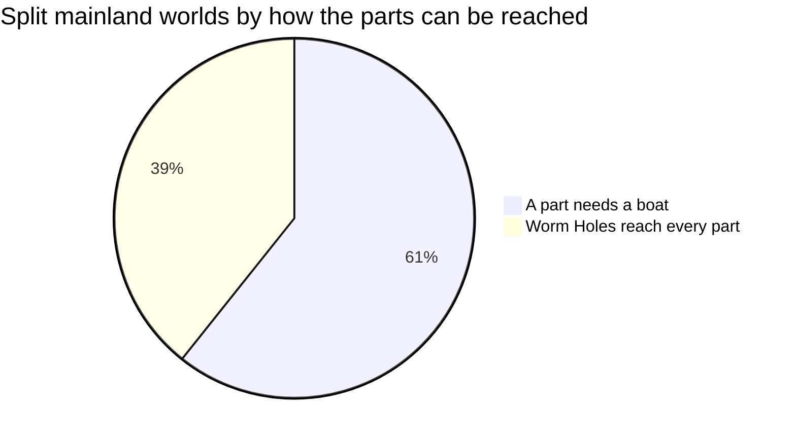

# Unusual islands

This data was computed by generating 1 million forest and 1 million cave worlds on version 762172 on Windows. Some seeds
are not possible (usually the worldgen algorithm gives up), so in this case 7,469 forest and 23,845 cave seeds failed to
generate.

## The mainland split by water

Normally the world is just one island, but very rarely the worldgen will break and fail to generate a road to a room
that is very far (or break in some other way). 

**Split mainland: worlds by the number of pieces**

| Pieces | Worlds | Example seeds |
| --- | ---: | ---: |
| 2 | 2,938 | 149, 330, 430, 1404 |
| 3 | 102 | 9899, 19672, 23456, 52100 |
| 4 | 4 | 146673, 424507, 522663, 526424 |

- The cut off part is usually much smaller than the rest: half of them are under 2,317 tiles, while the main part has
  about 45,142. The biggest one found has 28,726 tiles (seed 161267).
- In 80 of these worlds the Florid Postern is on the cut off part, so you spawn on the smaller piece. Example seeds:
  14508, 19672, 19889, 23456, 30506, 54213, 55784, 72060, 79312, 88494.
- In 1,848 of them (61%) at least one cut-off part has no Worm Hole to the rest either: you need a boat.

**Split mainland: the biome that makes up most of a cut-off part (3,154 parts)**

| Biome | Cut-off parts | Example seeds |
| --- | ---: | ---: |
| Forest hunters (Moonstone Forest) | 393 (12%) | 149, 430, 5492, 6891 |
| Badlands (Dragonfly Desert) | 367 (12%) | 1496, 7063, 8252, 15014 |
| For a nice walk (Mandrake Forest) | 306 (10%) | 2251, 4413, 8624, 8688 |
| Killer bees! (Killer Bee Field) | 282 (9%) | 1765, 10503, 16073, 22486 |
| The hunters (Triple MacTusk) | 281 (9%) | 5185, 16185, 18264, 20470 |
| Dig that rock (Mosaic) | 252 (8%) | 5998, 6675, 7486, 16628 |
| Squeltch (Marsh) | 219 (7%) | 1404, 2924, 3888, 5329 |
| Speak to the king (Pig King) | 214 (7%) | 1421, 14508, 14786, 20661 |

## The Lunar Island joined to the mainland

**Lunar Island: worlds by the water between the island and the mainland**

| Water between the island and the mainland | Worlds |
| --- | ---: |
| Joined (no water between them) | 2,611 (0.26%) |
| 1 to 3 tiles | 6,823 (0.69%) |
| 4 to 10 tiles | 5,272 (0.53%) |
| 11 to 20 tiles | 9,875 (0.99%) |
| 21 to 30 tiles | 32,748 (3.30%) |
| 31 to 40 tiles | 313,055 (31.54%) |
| 41 to 50 tiles | 475,299 (47.89%) |
| 51 tiles or more | 146,848 (14.80%) |

- Example seeds where the island is joined: 916, 1520, 2417, 2905, 3464, 3543, 3888, 4145, 4375, 4387.

## Moon Quay, Pearl's island and the Crab King

This is actually a set piece (you can see this by messing around with the filters on the map viewer), which contains 
the water tiles, so this will never be able to connect. Theoretically, maybe some world exists where these islands are
in other rooms (e.g. inside of Lunar), but I haven't found any. 

**Moon Quay, Pearl's island and the Crab King: distance to other land**

|  | Closest other land ever found | Usual distance to other land |
| --- | ---: | ---: |
| Moon Quay | 5 tiles | 41 tiles |
| Pearl's island | 5 tiles | 34 tiles |
| Crab King | 8 tiles | 21 tiles |
