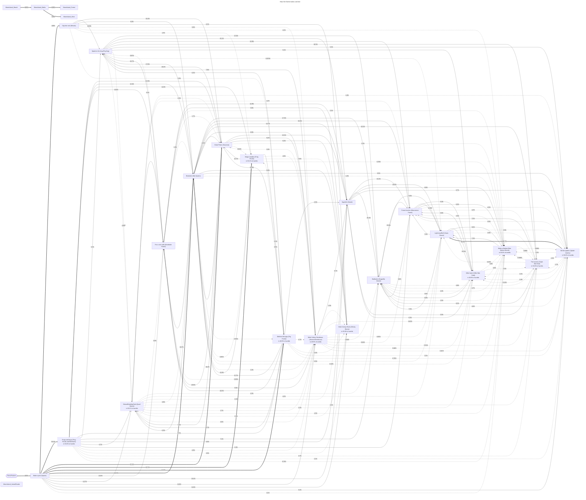

# Tasks megagraph

This data was computed by generating 1 million forest and 1 million cave worlds on version 762172 on Windows. Some seeds
are not possible (usually the worldgen algorithm gives up), so in this case 7,469 forest and 23,845 cave seeds failed to
generate.

## Forest

25 tasks and 175 different connections between them, from 992,531 worlds.

## Caves

51 tasks and 223 different connections between them, from 976,155 worlds.

```mermaid
---
title: How the caves tasks connect
---
flowchart LR
    classDef optional stroke-dasharray: 5 5
    spawn(["Florid Postern"])
    t0["ArchiveMaze"]
    t1["AtriumMaze"]
    t2["BigBatCave"]
    t3["BlueForest"]
    t4["CaveExitTask1"]
    t5["CaveExitTask2"]
    t6["CaveExitTask3"]
    t7["CaveExitTask4"]
    t8["CaveExitTask5"]
    t9["CaveExitTask6"]
    t10["CaveExitTask7"]
    t11["CaveExitTask8"]
    t12["CaveExitTask9"]
    t13["CaveExitTask10"]
    t14["CentipedeCaveTask"]
    t15["GreenForest"]
    t16["LichenLand"]
    t17["Military"]
    t18["MoonCaveForest"]
    t19["MudCave"]
    t20["MudLights"]
    t21["MudPit"]
    t22["MudWorld"]
    t23["RedForest"]
    t24["Residential"]
    t25["RockyLand"]
    t26["Sacred"]
    t27["SacredAltar"]
    t28["SpillagmiteCaverns"]
    t29["TheLabyrinth"]
    t30["ToadStoolTask1"]
    t31["ToadStoolTask2"]
    t32["ToadStoolTask3"]
    t33["BatCloister<br/>in 44.5% of worlds"]:::optional
    t34["CaveJungle<br/>in 44.3% of worlds"]:::optional
    t35["CaveSwamp<br/>in 44.5% of worlds"]:::optional
    t36["FungalNoiseForest<br/>in 44.6% of worlds"]:::optional
    t37["FungalNoiseMeadow<br/>in 44.3% of worlds"]:::optional
    t38["MilitaryPits<br/>in 43.3% of worlds"]:::optional
    t39["MoreAltars<br/>in 44.7% of worlds"]:::optional
    t40["MuddySacred<br/>in 44.5% of worlds"]:::optional
    t41["PleasantSinkhole<br/>in 44.6% of worlds"]:::optional
    t42["RabbitCity<br/>in 44.6% of worlds"]:::optional
    t43["RabbitSpiderWar<br/>in 44.6% of worlds"]:::optional
    t44["RabbitTown<br/>in 44.6% of worlds"]:::optional
    t45["Residential2<br/>in 44.4% of worlds"]:::optional
    t46["Residential3<br/>in 44.4% of worlds"]:::optional
    t47["SacredDanger<br/>in 44.5% of worlds"]:::optional
    t48["SpiderLand<br/>in 44.4% of worlds"]:::optional
    t49["SwampySinkhole<br/>in 44.6% of worlds"]:::optional
    t50["UndergroundForest<br/>in 44.6% of worlds"]:::optional
    spawn -->|"10.0%"| t7
    spawn -->|"10.0%"| t9
    spawn -->|"10.0%"| t13
    spawn -->|"10.0%"| t8
    spawn -->|"10.0%"| t4
    spawn -->|"10.0%"| t6
    spawn -->|"10.0%"| t10
    spawn -->|"10.0%"| t11
    spawn -->|"10.0%"| t5
    spawn -->|"9.9%"| t12
    t2 ==>|"44.3%"| t37
    t2 -->|"8.5%"| t33
    t2 -->|"5.4%"| t42
    t2 -->|"5.4%"| t35
    t2 -.->|"4.6%"| t31
    t2 -.->|"2.5%"| t44
    t2 -.->|"1.6%"| t48
    t2 -.->|"0.76%"| t43
    t2 -.->|"0.64%"| t41
    t2 -.->|"0.59%"| t36
    t2 -.->|"0.31%"| t49
    t2 -.->|"0.1%"| t32
    t2 -.->|"0.032%"| t50
    t3 ==>|"100%"| t18
    t3 ==>|"45.6%"| t4
    t3 ==>|"39.0%"| t5
    t3 ==>|"38.7%"| t6
    t3 ==>|"29.5%"| t7
    t9 -.->|"0.015%"| t13
    t9 -.->|"0.015%"| t8
    t9 -.->|"0.013%"| t10
    t9 -.->|"0.013%"| t11
    t9 -.->|"0.012%"| t12
    t9 -.->|"0.0002%"| t14
    t13 -.->|"0.17%"| t8
    t13 -.->|"0.17%"| t11
    t13 -.->|"0.17%"| t12
    t13 -.->|"0.16%"| t10
    t13 -.->|"0.11%"| t9
    t13 -.->|"0.0017%"| t14
    t15 ==>|"49.7%"| t31
    t15 ==>|"46.9%"| t5
    t15 ==>|"38.2%"| t6
    t15 ==>|"37.4%"| t4
    t15 ==>|"37.0%"| t7
    t15 -->|"16.4%"| t33
    t15 -->|"16.0%"| t43
    t15 -->|"15.2%"| t48
    t15 -->|"14.9%"| t35
    t15 -->|"11.4%"| t42
    t15 -->|"10.8%"| t36
    t15 -->|"10.4%"| t32
    t15 -->|"10.1%"| t49
    t15 -->|"8.7%"| t41
    t15 -->|"7.5%"| t44
    t15 -.->|"2.9%"| t50
    t16 ==>|"100%"| t24
    t16 ==>|"44.4%"| t46
    t16 ==>|"44.4%"| t45
    t16 ==>|"44.3%"| t34
    t17 ==>|"47.3%"| t29
    t17 ==>|"40.1%"| t27
    t18 ==>|"100%"| t0
    t19 ==>|"85.2%"| t28
    t19 -->|"22.3%"| t23
    t19 -->|"10.3%"| t3
    t19 -->|"9.7%"| t15
    t19 -->|"9.2%"| t30
    t19 -.->|"0.23%"| t12
    t19 -.->|"0.23%"| t13
    t19 -.->|"0.23%"| t10
    t19 -.->|"0.22%"| t8
    t19 -.->|"0.22%"| t11
    t19 -.->|"0.19%"| t9
    t19 -.->|"0.0022%"| t14
    t20 ==>|"100%"| t25
    t20 ==>|"51.0%"| t3
    t20 ==>|"37.8%"| t15
    t20 ==>|"29.4%"| t23
    t20 -->|"24.4%"| t30
    t20 -.->|"0.23%"| t10
    t20 -.->|"0.23%"| t13
    t20 -.->|"0.23%"| t9
    t20 -.->|"0.22%"| t8
    t20 -.->|"0.21%"| t11
    t20 -.->|"0.21%"| t12
    t20 -.->|"0.0041%"| t14
    t21 ==>|"100%"| t2
    t21 ==>|"66.4%"| t30
    t21 ==>|"52.5%"| t15
    t21 ==>|"48.4%"| t23
    t21 ==>|"38.8%"| t3
    t21 -->|"14.8%"| t28
    t21 -.->|"0.075%"| t11
    t21 -.->|"0.075%"| t10
    t21 -.->|"0.073%"| t8
    t21 -.->|"0.072%"| t12
    t21 -.->|"0.069%"| t13
    t21 -.->|"0.068%"| t9
    t21 -.->|"0.0022%"| t14
    t22 ==>|"100%"| t16
    t22 ==>|"100%"| t19
    t22 ==>|"100%"| t20
    t22 ==>|"100%"| t21
    t23 ==>|"33.5%"| t7
    t23 -->|"23.1%"| t6
    t23 -->|"17.0%"| t4
    t23 -->|"14.1%"| t5
    t23 -.->|"3.2%"| t48
    t23 -.->|"2.6%"| t49
    t23 -.->|"1.2%"| t43
    t23 -.->|"1.2%"| t36
    t23 -.->|"1.1%"| t41
    t23 -.->|"0.84%"| t35
    t23 -.->|"0.72%"| t33
    t23 -.->|"0.56%"| t31
    t23 -.->|"0.41%"| t42
    t23 -.->|"0.17%"| t13
    t23 -.->|"0.17%"| t9
    t23 -.->|"0.1%"| t44
    t23 -.->|"0.066%"| t11
    t23 -.->|"0.064%"| t12
    t23 -.->|"0.061%"| t10
    t23 -.->|"0.06%"| t8
    t23 -.->|"0.0025%"| t50
    t23 -.->|"0.00041%"| t14
    t24 ==>|"87.0%"| t26
    t24 ==>|"86.7%"| t17
    t24 ==>|"75.1%"| t1
    t24 ==>|"37.7%"| t38
    t25 ==>|"60.2%"| t32
    t25 ==>|"41.8%"| t31
    t25 ==>|"30.8%"| t50
    t25 -->|"24.1%"| t49
    t25 -->|"22.4%"| t43
    t25 -->|"19.9%"| t42
    t25 -->|"18.1%"| t35
    t25 -->|"17.0%"| t44
    t25 -->|"15.9%"| t33
    t25 -->|"13.3%"| t48
    t25 -->|"12.8%"| t36
    t25 -->|"9.8%"| t41
    t26 ==>|"50.5%"| t27
    t26 ==>|"44.7%"| t39
    t26 ==>|"44.5%"| t40
    t26 ==>|"44.5%"| t47
    t26 ==>|"37.1%"| t29
    t26 -.->|"0.22%"| t12
    t26 -.->|"0.21%"| t11
    t26 -.->|"0.21%"| t13
    t26 -.->|"0.21%"| t10
    t26 -.->|"0.21%"| t8
    t26 -.->|"0.18%"| t9
    t26 -.->|"0.0031%"| t14
    t27 -.->|"0.05%"| t9
    t27 -.->|"0.048%"| t13
    t27 -.->|"0.0046%"| t11
    t27 -.->|"0.0043%"| t10
    t27 -.->|"0.0038%"| t12
    t27 -.->|"0.0031%"| t8
    t27 -.->|"0.00061%"| t14
    t28 ==>|"29.3%"| t32
    t28 -->|"24.4%"| t41
    t28 -->|"19.3%"| t36
    t28 -->|"17.5%"| t44
    t28 -->|"11.1%"| t48
    t28 -->|"10.9%"| t50
    t28 -->|"7.6%"| t42
    t28 -->|"7.4%"| t49
    t28 -->|"5.3%"| t35
    t28 -.->|"4.2%"| t43
    t28 -.->|"3.3%"| t31
    t28 -.->|"3.0%"| t33
    t33 -->|"7.4%"| t14
    t33 -.->|"0.0034%"| t9
    t33 -.->|"0.0026%"| t13
    t34 -->|"24.9%"| t1
    t34 -->|"13.3%"| t17
    t34 -->|"13.0%"| t26
    t34 -->|"5.5%"| t38
    t36 -->|"19.3%"| t10
    t36 -->|"17.5%"| t13
    t36 -->|"12.5%"| t12
    t36 -->|"11.2%"| t8
    t36 -->|"10.7%"| t11
    t36 -->|"10.6%"| t9
    t36 -->|"7.6%"| t14
    t37 -->|"23.3%"| t11
    t37 -->|"20.6%"| t8
    t37 -->|"19.3%"| t12
    t37 -->|"18.2%"| t9
    t37 -->|"15.8%"| t14
    t37 -->|"14.3%"| t10
    t37 -->|"12.8%"| t13
    t38 -->|"15.6%"| t29
    t38 -->|"9.4%"| t27
    t41 -->|"19.4%"| t10
    t41 -->|"17.9%"| t13
    t41 -->|"13.3%"| t12
    t41 -->|"11.3%"| t9
    t41 -->|"10.9%"| t8
    t41 -->|"10.5%"| t11
    t41 -->|"7.0%"| t14
    t42 -->|"22.3%"| t11
    t42 -->|"20.6%"| t8
    t42 -->|"20.4%"| t12
    t42 -->|"19.5%"| t9
    t42 -->|"15.7%"| t14
    t42 -->|"13.7%"| t13
    t42 -->|"13.3%"| t10
    t43 -->|"13.0%"| t14
    t44 -->|"21.4%"| t13
    t44 -->|"20.7%"| t9
    t44 -->|"16.0%"| t10
    t44 -->|"15.8%"| t12
    t44 -->|"15.6%"| t8
    t44 -->|"10.9%"| t14
    t44 -->|"10.7%"| t11
    t45 -.->|"0.15%"| t11
    t45 -.->|"0.15%"| t13
    t45 -.->|"0.15%"| t8
    t45 -.->|"0.15%"| t12
    t45 -.->|"0.14%"| t10
    t45 -.->|"0.13%"| t9
    t45 -.->|"0.0031%"| t14
    t48 -->|"13.4%"| t14
    t50 -->|"21.3%"| t11
    t50 -->|"20.0%"| t8
    t50 -->|"18.5%"| t9
    t50 -->|"17.5%"| t12
    t50 -->|"16.6%"| t10
    t50 -->|"15.6%"| t13
    t50 -->|"9.2%"| t14
```

